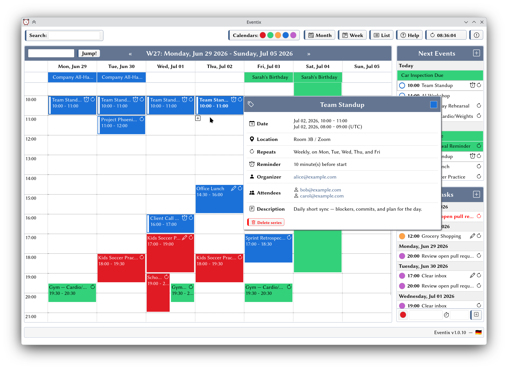
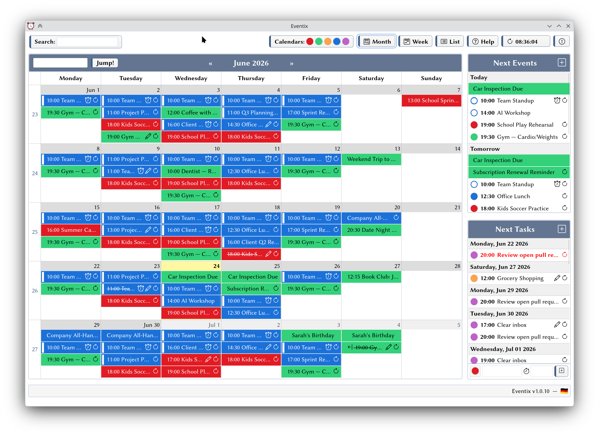
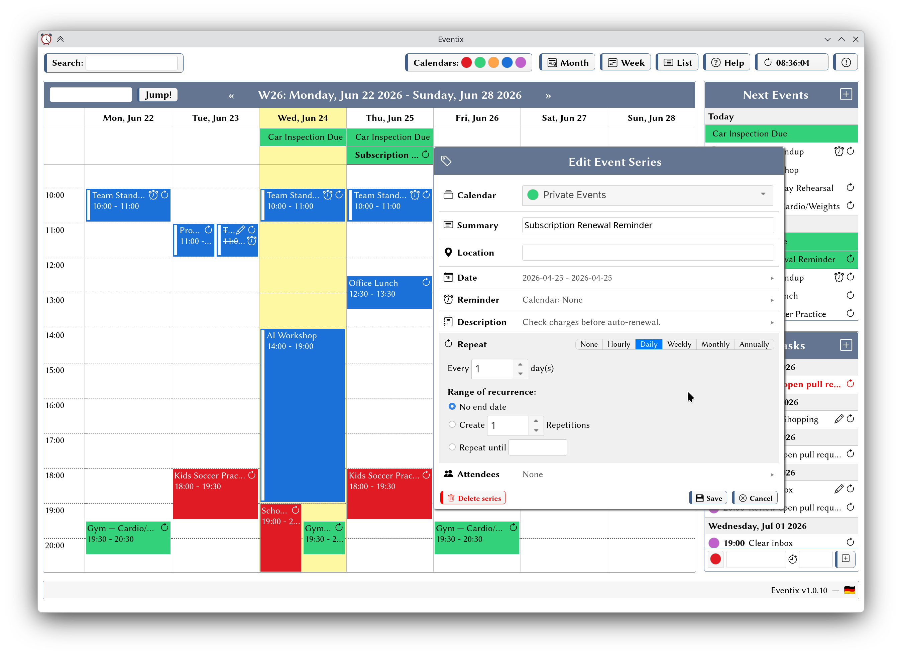
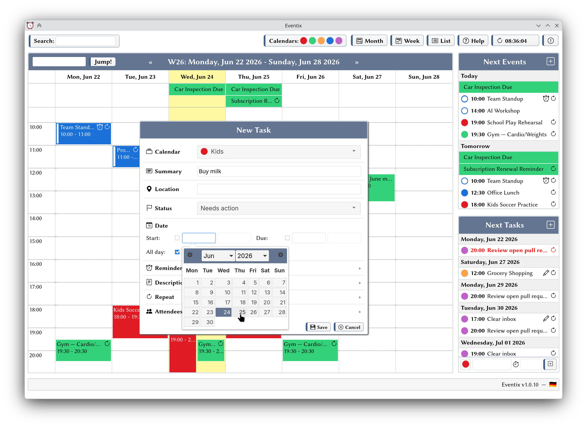
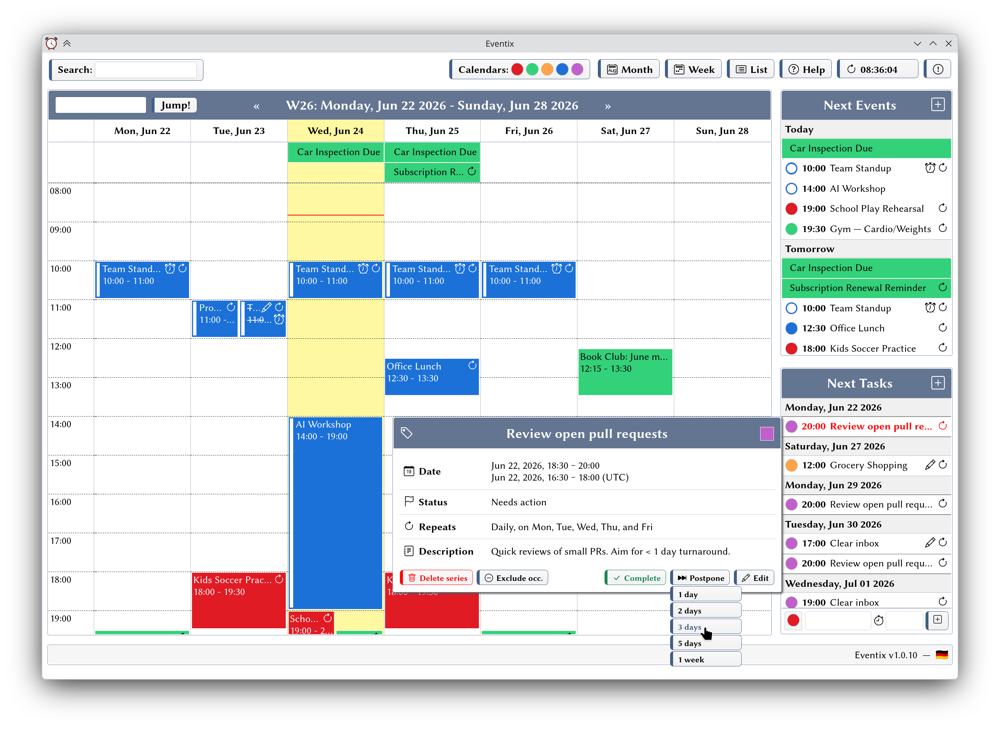
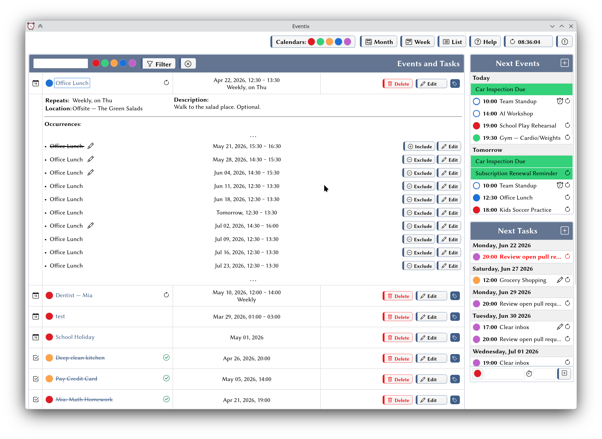
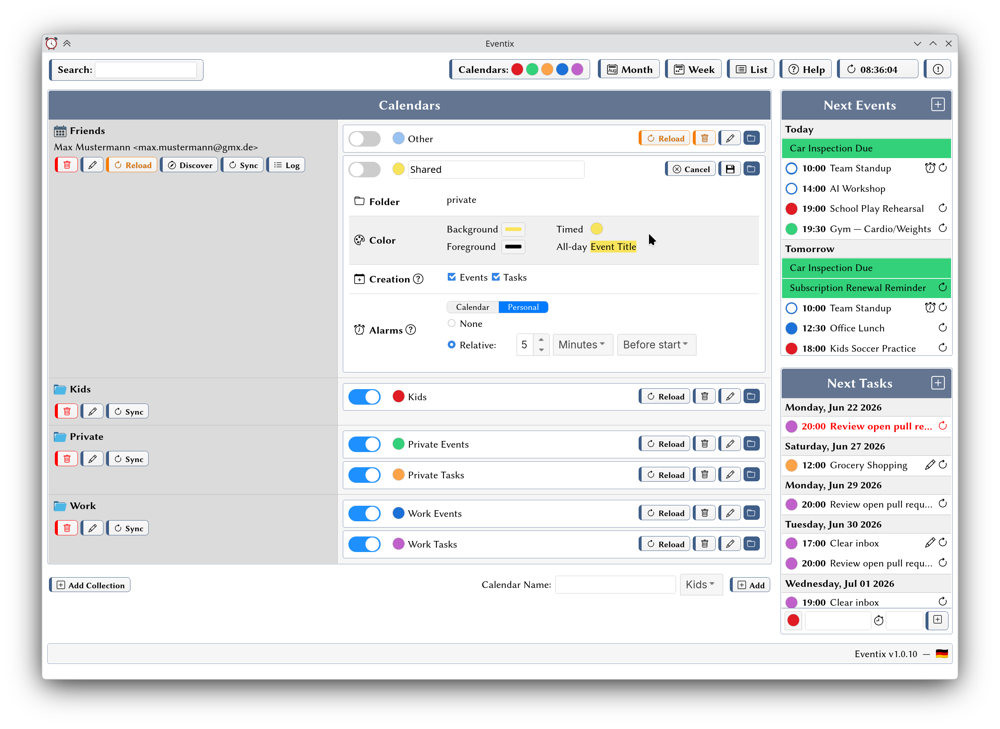
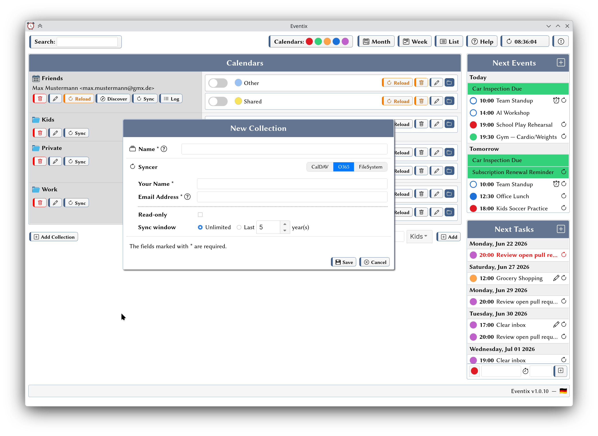

# Eventix

[](https://codecov.io/github/hrniels/Eventix)

Eventix is a native GTK4 calendar and task manager for Linux desktops, supporting CalDAV and
Microsoft 365 (Exchange).

## Features

- Monthly, weekly, and list calendar views
- Event and task creation, editing, deletion, and recurring items
- Mostly complete implementation of the iCalendar standard (RFC 5545)
- Organized events with attendees and accept/decline
- Calendar alarms and per-calendar personal reminder overrides
- CalDAV synchronization via [vdirsyncer](https://github.com/pimutils/vdirsyncer) (bundled)
- Microsoft 365 synchronization via [DavMail](http://davmail.sourceforge.net/) (bundled)
- Local filesystem calendars (no synchronization required)
- iCalendar (`.ics`) import with a preview and overwrite warnings
- System tray icon showing due-today and overdue task counts
- English and German translations
- XDG-compliant configuration and data storage
- Flatpak packaging (`io.github.hrniels.Eventix`)

## Screenshots

| | |
|:---:|:---:|
|  |  |
|  |  |
|  |  |
|  |  |

## Installation

Eventix is distributed through [Flathub](https://flathub.org/en/apps/io.github.hrniels.Eventix).
To build and install a Flatpak from source instead:

```bash
./b flatpak
flatpak install --user flatpak/Eventix.flatpak
```

## Running

Launch Eventix from the desktop application menu or run:

```bash
flatpak run io.github.hrniels.Eventix
```

The package launches `eventix-gtk`. Click the tray icon to hide or restore the window; alarms and
background synchronization continue while it is hidden. Closing the window or using the tray's
Quit action exits the application. Use `--no-tray` to disable tray integration. There is no separate
background daemon; alarms and synchronization stop when Eventix exits.

### Importing calendar files

Open an iCalendar file from the file manager with Eventix to preview and import its events/tasks.
This starts Eventix when needed, or brings the running instance forward with a modal import dialog.
Multiple files are presented one at a time. Files and file URIs can also be passed directly:

```bash
flatpak run --file-forwarding io.github.hrniels.Eventix @@ /path/to/invitation.ics @@
```

## Configuration and data

Collections, calendars, and preferences can be managed in the GTK UI. Configuration and data use
XDG-standard locations under the application ID `io.github.hrniels.Eventix`. In Flatpak, the base
directory is `$HOME/.var/app/io.github.hrniels.Eventix`:

| File | Purpose |
| --- | --- |
| `<base>/config/io.github.hrniels.Eventix/settings.toml` | Collections, calendars, preferences |
| `<base>/data/io.github.hrniels.Eventix/misc.toml` | Last alarm check, calendar visibility, sync state |
| `<base>/data/io.github.hrniels.Eventix/alarms/` | Personal reminders |
| `<base>/data/io.github.hrniels.Eventix/vdirsyncer/` | Calendar files from remote servers |

## Development

Building requires stable Rust, GTK4 development libraries (GTK 4.10 or newer), `pkg-config`, and
`glib-compile-resources` from the GLib development tools. Synchronization helpers require Python
with venv/pip and a Java JDK with Maven and Ant.

Prepare the bundled helpers and launch with project-local configuration/data in `run/`:

```bash
./b vdirsyncer
./b davmail
./b run
./b run --date 2026-11-09
./b import /path/to/invitation.ics
```

`./b watch` rebuilds and relaunches on changes (requires `cargo-watch`). Both `run` and `watch` pass
additional arguments to `eventix-gtk`; use `--` to separate them from the launcher's own options.

Debug builds default to the `io.github.hrniels.Eventix-debug` data/config prefix; release builds use
`io.github.hrniels.Eventix`. `--data-prefix` selects another prefix:

```bash
./b run --data-prefix io.github.hrniels.Eventix
```

### Tests and formatting

```bash
./b test
./b test -p eventix-state
./b format
./b format-check
cargo clippy --all-targets --all-features
```

Use `./b test` rather than invoking Cargo tests directly so bundled helpers are available.
CalDAV integration tests require Radicale. Run display-dependent GTK tests on an invisible Xvfb
display with Openbox and a separate D-Bus session:

```bash
./b test-ui
./b test-ui styled_hour_labels
```

Required tools are `xvfb-run`, `Xvfb`, `xauth`, `dbus-run-session`, `openbox`, and `xprop`. Use `./b
test-ui --visible` only for interactive debugging on the current desktop, and `--nocapture` to show
output from passing tests. Formatting also requires `yamlfmt`.

## Architecture

```text
eventix/
├── bin/
│   ├── gtk/            # GTK4 UI, tray, imports, notifications
│   └── getpw/          # Password helper for vdirsyncer
├── libs/
│   ├── ical/           # RFC 5545 parser, object model, recurrence
│   ├── state/          # Settings, actions, synchronization, personal alarms
│   ├── locale/         # Locale/i18n support
│   └── view/           # Calendar snapshots, details, editors, overlap layout
├── data/               # Application icons and locale overrides
├── flatpak/            # Build manifest, desktop entry, AppStream metadata
├── contrib/davmail/    # Microsoft 365 CalDAV bridge
└── contrib/vdirsyncer/ # Bundled CalDAV synchronization
```

GTK composite templates, styles, and UI icons live in `bin/gtk/resources/` and are bundled into the
executable using GResource. Translations use the TOML locale system rather than GtkBuilder gettext
support.

## License

Eventix is licensed under the [GNU General Public License v3.0 or later](LICENSE)
(SPDX: `GPL-3.0-or-later`). Bundled third-party components retain their own licenses:

- [DavMail](http://davmail.sourceforge.net/) (`contrib/davmail/`) — GPL-2.0
- [vdirsyncer](https://github.com/pimutils/vdirsyncer) (`contrib/vdirsyncer/`) — BSD-3-Clause
